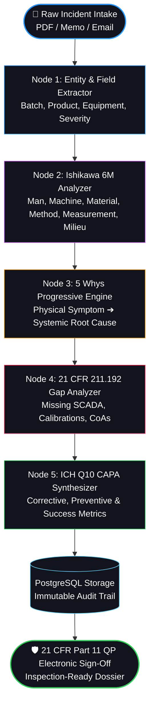

<div align="center">

# ⚗️ QUALIS AI
### Autonomous Pharmaceutical Root Cause Analysis (RCA) & CAPA Platform
**Engineered for Active Pharmaceutical Ingredient (API) Synthesis • cGMP 21 CFR Part 11 Compliant**

[](https://fastapi.tiangolo.com)
[](https://github.com/langchain-ai/langgraph)
[](https://groq.com)
[](https://react.dev)
[](https://www.typescriptlang.org)
[](https://www.postgresql.org)
[](https://www.fda.gov)
[](LICENSE)

<br/>

[🚀 Quick Start](#-quick-start) • [✨ Key Capabilities](#-key-capabilities) • [🧠 LangGraph AI Architecture](#-langgraph-ai-architecture) • [🧪 Benchmark Scenarios](#-benchmark-api-scenarios) • [🛡️ Compliance Matrix](#-regulatory-compliance-matrix) • [🎥 Recording Guide](#-submission-recording-guide)

</div>

---

## 📌 Executive Overview

In commercial Active Pharmaceutical Ingredient (API) manufacturing, an unresolved batch deviation can halt multi-million dollar release campaigns, trigger FDA 483 inspection observations, or result in catastrophic product recalls. Traditional deviation handling is plagued by fragmented SCADA chronologies, manual paperwork, and superficial root causes that lead to recurring out-of-specification (OOS) batches.

**Qualis AI** transforms pharmaceutical deviation investigations from slow, form-heavy administrative tasks into an autonomous, AI-orchestrated causal discovery process. Built strictly according to **FDA 21 CFR Part 211 / Part 11**, **ICH Q7** (GMP for APIs), **ICH Q9** (Quality Risk Management), and **ICH Q10** (Pharmaceutical Quality Systems), Qualis delivers defensible root cause analysis and verified CAPAs in under 90 seconds.

---

## ✨ Key Capabilities

### 1. Multi-Modal Evidence Intake
- **Flexible Document Ingestion**: Ingest native PDF batch manufacturing records, SCADA alarm printouts, shift handover logs, or plain text incident summaries via `pypdf`.
- **Pre-Configured API Scenarios**: Instant 1-click loading of verified benchmark scenarios covering critical API unit operations (Crystallization, Fluidized Drying, Centrifugation).

### 2. Dual Investigation Frameworks
- **Progressive 5 Whys Chain**: Escalates causally from immediate physical symptoms through mechanical failure mechanisms down to systemic organizational and preventive maintenance failures.
- **Ishikawa 6M Matrix**: Categorizes causal factors across **Man**, **Machine**, **Material**, **Method**, **Measurement**, and **Milieu** with investigator confirmation toggles and likelihood scoring (High, Medium, Low, Ruled Out).

### 3. Missing Evidence & 21 CFR § 211.192 Gap Detection
- Identifies critical missing documentation (e.g. SCADA 1-second trend logs, calibration certificates, raw material vendor CoAs, OEM metallurgical analyses) required by regulatory auditors before batch disposition.
- Allows investigators to mark missing items as *Provided* with verifiable attachment references.

### 4. ICH Q10 CAPA Formulation & Effectiveness Criteria
- Explicitly bifurcates actions into **Corrective Actions** (immediate containment & batch disposition) and **Preventive Actions** (systemic recurrence prevention).
- Mandates quantifiable **Effectiveness Check Plans** (e.g., *"Zero recurring temperature excursions across the next 5 commercial production campaigns"*).

### 5. 21 CFR Part 11 Electronic Signature & Audit Dossier
- Cryptographic **Qualified Person (QP) Electronic Sign-off** with legal meaning, reviewer credentials, and cryptographic timestamp.
- **1-Click Audit Dossier**: Generates an inspection-ready, print-formatted regulatory dossier for FDA, EMA, or CDSCO compliance auditors.

---

## 🧠 LangGraph AI Architecture

Qualis AI utilizes a sequential 5-node **LangGraph StateGraph** pipeline powered by **Groq (`llama-3.3-70b-versatile` / `gemma2-9b-it`)** with zero-latency token streaming and guaranteed Pydantic JSON schema output:



> **Built-in Resilience**: Includes a high-fidelity **Pharmaceutical Domain Fallback Engine**. If no Groq API key is configured or network drops occur, the pipeline automatically provides compliant cGMP analytical data without crashing.

---

## 🧪 Benchmark API Scenarios

Qualis includes 3 pre-loaded real-world pharmaceutical API deviation benchmarks:

| Benchmark Scenario | Product & Unit Operation | Severity | Primary Failure Mode |
| :--- | :--- | :---: | :--- |
| **Scenario 1** | **Atorvastatin Calcium Trihydrate**<br/>`Batch #PAR-2024-089` • Crystallization | <span style="color:#ff375f">**CRITICAL**</span> | Glycol chiller thermal control valve hysteresis causing polymorphic impurity OOS. |
| **Scenario 2** | **Metformin Hydrochloride**<br/>`Batch #AMX-2024-042` • Fluidized Drying | <span style="color:#ff9f0a">**MAJOR**</span> | Dutch-weave air distributor screen blinding leading to thermal degradation degradant. |
| **Scenario 3** | **Paracetamol (Acetaminophen)**<br/>`Batch #MET-2024-118` • Centrifugation | <span style="color:#2997ff">**MINOR**</span> | Hastelloy basket carbon seal face degradation depositing foreign black particulates. |

---

## 🛡️ Regulatory Compliance Matrix

| Regulation | Regulatory Requirement | Qualis AI Technical Implementation |
| :--- | :--- | :--- |
| **FDA 21 CFR § 211.192** | Thorough investigation of any unexplained discrepancy or batch failure. | Automated 5 Whys progression and 6M Ishikawa factor interrogation down to systemic root cause. |
| **FDA 21 CFR § 211.192** | Written record of investigation including conclusions and follow-up. | Immutable audit trail recorded in PostgreSQL with automated report generation. |
| **FDA 21 CFR Part 11** | Signed electronic records with identity verification and timestamps. | Qualified Person (QP) cryptographic signature modal with reason for signing and UTC timestamp. |
| **ICH Q7 § 12.2** | Deviation investigations and appropriate corrective actions for APIs. | Separation of immediate containment from systemic preventive recurrence controls. |
| **ICH Q10 § 3.2** | CAPA methodology with mandatory effectiveness checks. | Mandatory quantifiable effectiveness criteria tracked across future commercial batches. |

---

## 🚀 Quick Start

### 1. Prerequisites
- **Python 3.10+** (Python 3.14 fully supported)
- **Node.js 18+** and **npm**
- **PostgreSQL 14+** running locally (database: `qualis_rca`)

### 2. Environment Setup

```bash
# Clone the repository
git clone https://github.com/prince-rai88/Qualis.git
cd Qualis

# Configure environment variables (optional: add your GROQ_API_KEY)
cp backend/.env.example backend/.env 2>/dev/null || true
```

### 3. Backend Setup & Launch

```bash
# Activate Python virtual environment and install dependencies
python3 -m venv venv
source venv/bin/activate
pip install -r backend/requirements.txt

# Start the FastAPI Uvicorn server
uvicorn backend.main:app --host 127.0.0.1 --port 8000 --reload
```
*API documentation and interactive Swagger UI will be available at: **[http://127.0.0.1:8000/docs](http://127.0.0.1:8000/docs)***

### 4. Frontend Setup & Launch

```bash
# In a new terminal window:
cd frontend
npm install
npm run dev
```
*Access the application in your browser at: **[http://localhost:5173](http://localhost:5173)***

---

## 🎨 UI Architecture: Apple Dark Pro OLED Glass

Qualis AI features a bespoke **Apple Dark Pro** design language engineered specifically for high-stress technical investigations:
- **True OLED Obsidian Canvas (`#000000` / `#060709`)**: Maximizes readability and minimizes eye fatigue in cleanroom control rooms.
- **Frosted Translucent Plates**: Multi-layered glass blur (`backdrop-filter: blur(28px) saturate(190%)`) with top specular reflection highlights (`border-top: 1px solid rgba(255, 255, 255, 0.24)`).
- **High-Impact Status Badges**: Neon Crimson (`#ff375f`), Neon Amber (`#ff9f0a`), Apple Pro Blue (`#2997ff`), and Neon Emerald (`#30d158`).
- **Interactive Controls**: Capabilities ribbon, glowing CTA capsules, and responsive 5 Whys connector nodes.

---

## 🎥 Submission Recording Guide

### Video 1: Product Demonstration (5–8 minutes)
1. **Introduction (0:00 - 1:00)**:
   - Introduce Qualis AI as an autonomous, cGMP-compliant RCA & CAPA module for API manufacturers.
   - Point out the clean Apple Dark Pro interface and regulatory badges.
2. **Multi-Modal Intake (1:00 - 2:00)**:
   - Show text paste, email input, and PDF upload.
   - Click the **Atorvastatin Calcium Trihydrate** preset card to instantly populate the scenario.
3. **5-Stage AI Investigation (2:00 - 3:30)**:
   - Click **"Synthesize RCA →"** and follow the live stepper through Entity Extraction, 6M Fishbone, 5 Whys, Evidence Gaps, and CAPA.
4. **Root Cause Analysis (3:30 - 5:00)**:
   - Explore the **5 Whys Progressive Chain** down to the systemic preventive maintenance deferral.
   - Switch to the **Ishikawa 6M Matrix** and toggle investigator verification.
5. **Evidence Gaps & CAPA (5:00 - 6:30)**:
   - Review missing SCADA calibration records under 21 CFR 211.192. Click "Mark Provided".
   - Review Corrective vs. Preventive actions and the quantifiable effectiveness metric.
6. **QP Electronic Sign-Off & Audit Dossier (6:30 - 8:00)**:
   - Open **QP Sign-Off**, enter review comments, and execute the 21 CFR Part 11 electronic signature.
   - Open the **Audit Dossier** to demonstrate the inspection-ready PDF/print defense package.

### Video 2: Technical Walkthrough (5–10 minutes)
1. **Frontend Architecture**: React 18, Redux Toolkit slices (`investigationSlice.ts`, `aiSlice.ts`), and optimistic UI updates.
2. **Backend & Endpoints**: FastAPI route modules (`backend/routes/investigations.py`, `backend/routes/ai_rca.py`) and PDF ingestion.
3. **LangGraph Implementation**: StateGraph workflow in `backend/ai/graph.py` and sequential nodes in `backend/ai/nodes.py`.
4. **Database & Compliance**: PostgreSQL models (`backend/models.py`), immutable audit trails, and 21 CFR Part 11 data integrity.

---

## 📄 License
This project is licensed under the MIT License — see the [LICENSE](LICENSE) file for details.
